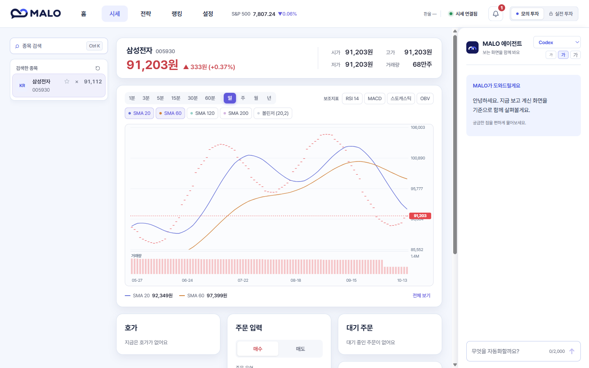
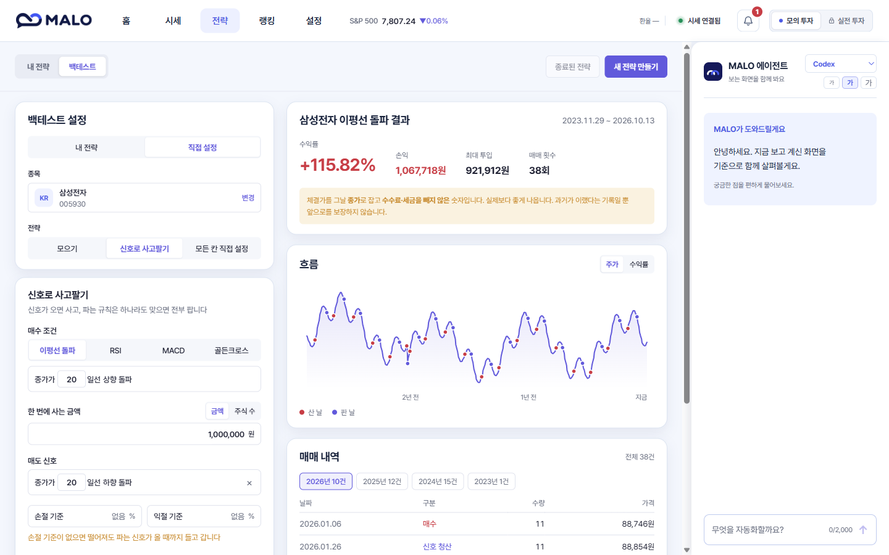

<p align="center"><strong>PROJECT PORTFOLIO · FINTECH</strong></p>

<p align="center">
  
</p>

<h1 align="center">MALO</h1>

<p align="center"><strong>My Agent for Linked Orders · 말로 만드는 개인 투자 전략</strong></p>

<p align="center">
  자연어 전략 생성 · 사용자 승인 · 백테스트 · 모의투자 실행<br />
  <strong>Frontend Developer 김태은</strong>
</p>

MALO는 사용자가 말로 설명한 투자 아이디어를 실행 가능한 규칙으로 바꾸고, 백테스트와 사용자 승인을 거쳐 모의투자에서 지속 실행하는 개인 투자 에이전트입니다.

단순히 AI가 투자 답변을 생성하는 서비스가 아니라, 자연어를 검증 가능한 전략 DSL로 변환하고 승인된 규칙을 여러 거래일에 걸쳐 실행하는 **실행 엔진 중심의 서비스**입니다. AI는 전략을 만들고 설명하는 교체 가능한 접점이며, 실제 투자 규칙의 검증·승인·실행은 상태 머신과 스케줄러가 담당합니다.

<p align="center">
  
  
</p>

## CONTENTS

`01 Overview` · `02 Core Value` · `03 My Contribution` · `04 Service Design` · `05 Key Features` · `06 Screens` · `07 Tech Stack` · `08 Technical Highlights` · `09 Problem Solving` · `10 Outcome` · `11 Architecture`

---

## 01. PROJECT OVERVIEW

> **말로 설명한 투자 아이디어를 검증 가능한 전략으로 바꾸고, 사용자가 승인한 규칙만 지속 실행합니다.**

| 항목 | 내용 |
|---|---|
| 서비스명 | MALO (My Agent for Linked Orders) |
| 서비스 형태 | 자연어 기반 개인 투자 전략 생성·검증·실행 서비스 |
| 핵심 사용자 | 투자 전략을 코드 없이 만들고 모의 검증하려는 개인 투자자 |
| 핵심 흐름 | 자연어 요청 → 전략 초안 → 사용자 승인 → 백테스트·모의 실행 → 결과 확인 |
| 주요 화면 | 홈, 시세, 전략, 백테스트, 랭킹, 설정, AI 채팅 |
| 증권 연동 | 토스증권 Open API |
| 실행 환경 | Windows 개인 PC의 로컬 웹 애플리케이션 |
| 담당 역할 | 김태은 · Frontend Developer |

### PROJECT SUMMARY

대화로 투자 전략을 만들고, 차트와 백테스트로 검증한 뒤, 사용자가 승인한 범위 안에서 실행하는 개인 투자 에이전트입니다.

| **289 / 289** | **31** | **9** | **6** |
|:---:|:---:|:---:|:---:|
| Core 테스트 통과 | MCP 도구 | 전략 카드 | Mock 시나리오 |

---

## 02. CORE VALUE

> AI의 답변을 보여주는 데서 끝나지 않고, 실제로 검증하고 실행할 수 있는 투자 전략으로 연결했습니다.

| 관점 | 내용 |
|---|---|
| **Problem** | 투자 아이디어가 있어도 복잡한 주문식과 코드를 직접 작성해야 하며, AI의 답변을 실제 실행 규칙으로 신뢰하기 어렵습니다. |
| **Solution** | 자연어 요청을 검증 가능한 전략 DSL로 변환하고, 서버 검증과 사용자 승인을 통과한 전략만 독립 실행 엔진에 등록했습니다. |
| **Difference** | AI가 주문을 직접 수행하지 않습니다. AI는 전략 생성과 설명을 담당하고, 실행은 상태 머신과 스케줄러가 일관된 규칙으로 처리합니다. |
| **My Role** | React·TypeScript 기반 핵심 화면과 첫 실행 흐름을 구현하고, 실시간 투자 데이터를 사용자가 판단하고 조작할 수 있는 UI로 연결했습니다. |
| **Quality** | 접근 가능한 공통 Overlay, 안전한 Markdown 렌더링, UI 회귀 테스트와 GitLab CI의 정적 번들 검증을 적용했습니다. |

### DESIGN FOCUS

1. **처음 실행해도 막히지 않도록** 토스·AI 연결 상태에 따라 온보딩 흐름을 분기했습니다.
2. **투자 판단의 맥락이 끊기지 않도록** 종목 탐색, 차트 분석, 주문과 AI 상담을 하나의 화면에 구성했습니다.
3. **AI의 답변을 그대로 믿지 않도록** 전략 조건과 위험 정보를 읽기 쉬운 승인 화면으로 연결했습니다.
4. **실시간 데이터가 갱신되어도 안정적으로 조작하도록** 모달의 초점, 레이어와 생명주기를 정리했습니다.
5. **개발 화면과 실제 배포 화면이 달라지지 않도록** 프런트엔드 산출물 검증을 CI에 추가했습니다.

---

## 03. MY CONTRIBUTION

### 김태은 · FRONTEND DEVELOPER

서비스의 주요 화면을 React와 TypeScript로 구현하고, API에서 받은 투자 정보를 사용자가 이해하고 조작할 수 있는 화면 흐름으로 연결했습니다. 단순 마크업보다 첫 실행, 데이터 로딩, 연결 실패, 모달 중첩과 같은 실제 사용 상태를 구분하는 데 집중했습니다.

| 담당 영역 | 구체적인 기여 |
|---|---|
| 홈 대시보드 | 자산 요약, 실행 중 전략, 포트폴리오 분석, 보유 종목 UI 개선 및 전략 정보 우선 배치 |
| 시세 화면 | 종목 검색, 현재가 요약, 기술 지표 차트, 호가·주문·대기 주문 영역의 정보 구조와 가독성 개선 |
| 전략·백테스트 | 전략 카드와 상세 드로어, 생성 화면, 전략 상태별 동작, 백테스트 조건 입력 및 결과·거래 내역 시각화 |
| 랭킹·설정 | 일간·주간 랭킹, 과거 결과 조회, 참가 흐름, 토스·AI·PIN·MCP 설정 화면 개선 |
| 첫 실행 경험 | 서버와 토스 연결 상태를 확인해 신규 설정·연결 복구·정상 진입을 구분하는 온보딩 상태 흐름 구현 |
| AI 채팅 UI | AI 공급자 상태, Markdown 표·코드·링크 렌더링, 승인 카드와 실패 안내의 가독성 개선 |
| 공통 UX | 모달·드로어의 초점 이동, Esc·바깥 클릭 닫기, 포커스 트랩, 채팅 패널과의 레이어 충돌 해결 |
| 품질·CI | Vitest 기반 UI 회귀 테스트, Oxlint 적용, GitLab CI 프런트 검증과 정적 번들 최신 상태 검사 개선 |

### OWNED USER JOURNEY

```text
첫 실행 및 연결 상태 확인
  → 홈에서 자산·전략 상태 확인
  → 시세에서 종목 검색·차트 분석·모의 주문
  → 전략 조건 설정 또는 AI 초안 확인
  → 백테스트 결과 비교
  → 전략 등록·상세·실행 상태 관리
  → 랭킹과 설정에서 성과·연결 상태 확인
```

---

## 04. SERVICE DESIGN

> 사용자는 자연어로 시작하지만, 실행은 반드시 구조화된 규칙과 명시적인 승인을 거칩니다.

### SERVICE CONCEPT

MALO는 투자 전략을 생각은 했지만 복잡한 주문식이나 코드를 직접 작성하기 어려운 사용자를 위한 로컬 기반 자동 투자 서비스입니다. 사용자는 “삼성전자가 20일 이동평균선을 위로 돌파하면 100만 원어치 사고, 다시 아래로 내려가면 팔아 줘”와 같이 평소 사용하는 문장으로 전략을 요청할 수 있습니다.

서비스는 이 요청을 그대로 실행하지 않습니다. 먼저 종목, 매수 금액, 진입 조건, 청산 조건, 손절·익절 기준과 실행 기간을 구조화된 전략으로 변환하고, 지원하지 않는 조건이나 빠진 값이 있는지 검증합니다. 이후 사람이 이해할 수 있는 문장과 표로 실행 내용을 보여주며, 사용자가 최종 승인한 전략만 모의 계좌에 등록합니다.

등록된 전략은 AI 대화 세션과 분리되어 동작합니다. AI가 종료되거나 연결되지 않아도 Spring Boot 실행 엔진이 거래일, 시장 시간과 가격 조건을 확인해 전략을 평가하고, 주문·체결·평가 기록을 자체 원장에 남깁니다. 사용자는 홈, 시세, 전략과 백테스트 화면에서 실행 상태와 결과를 다시 확인할 수 있습니다.

### USER FLOW

```text
자연어로 투자 아이디어 입력
  → AI가 전략 초안과 부족한 조건 정리
  → 서버가 지원 범위·금액·위험 조건 검증
  → 사용자가 실행 문장과 조건 확인
  → 최종 승인된 전략만 등록
  → 상태 머신과 스케줄러가 지속 평가
  → 시세·체결·손익·평가 근거 확인
```

### PRODUCT GOALS

| 목표 | 제품에 반영한 방식 |
|---|---|
| **쉬운 전략 작성** | 전문 주문식 대신 자연어로 전략을 설명하고, 빠진 금액·횟수·기간은 대화를 통해 구체화합니다. |
| **안전한 실행 경계** | AI 답변을 바로 주문하지 않고 DSL 검증, 서버 검증과 사용자 최종 승인을 차례로 거칩니다. |
| **지속 가능한 실행** | 승인 이후에는 AI가 아닌 상태 머신과 스케줄러가 시장 일정에 맞춰 같은 규칙을 반복 평가합니다. |
| **설명 가능한 결과** | 수익률뿐 아니라 조건 충족 여부, 주문·체결 시점과 실행되지 않은 이유를 함께 기록합니다. |
| **로컬 데이터 관리** | 토스 API 키, 전략과 모의 원장은 사용자 PC에 저장하고 핵심 실행 엔진도 로컬에서 운영합니다. |

### WHY MALO

자동 투자 서비스를 사용하려면 전략 조건을 코드나 복잡한 주문식으로 작성해야 하는 경우가 많습니다. 또한 AI에게 투자 아이디어를 물어볼 수는 있어도, 답변이 실제 실행 가능한 규칙으로 이어지지 않거나 사용자의 확인 없이 동작해서는 안 됩니다.

MALO는 이 간극을 줄이기 위해 다음 흐름을 하나의 제품 안에 구성했습니다.

1. 사용자가 일상적인 문장으로 투자 방식을 요청합니다.
2. AI가 요청을 구조화된 전략 초안으로 변환합니다.
3. 서비스가 지원 여부와 위험 조건을 검증해 사람이 읽을 수 있는 문장으로 보여줍니다.
4. 사용자가 승인한 전략만 실행 엔진에 등록합니다.
5. 등록 이후에는 AI가 없어도 상태 머신과 스케줄러가 전략을 지속 실행합니다.
6. 사용자는 시세·체결·평가 기록과 백테스트 결과를 화면에서 확인합니다.

---

## 05. KEY FEATURES

### 1. 자연어 전략 생성과 승인

- AI 채팅을 통한 투자 전략 요청
- 자연어를 검증 가능한 전략 규칙으로 변환
- 종목·금액·매수·매도·손절·익절 조건 미리보기
- 사용자 최종 승인 이후에만 전략 등록
- Codex·Claude 등 AI 공급자 선택과 연결 상태 안내

### 2. 시세 분석과 모의 주문

- 국내·미국 종목 검색과 최근 검색 종목 관리
- 일·주·월·연봉 및 분봉 차트 제공
- SMA, RSI, MACD, 스토캐스틱, OBV 등 기술 지표 선택
- 현재가·등락률·거래량과 주문 입력을 한 화면에 구성
- 가상 잔액을 사용하는 모의 매수·매도 및 대기 주문 확인

### 3. 전략 관리와 백테스트

- 실행·일시정지·확인 필요·종료 상태별 전략 관리
- 전략 상세 규칙과 평가 이력 확인
- 신호 매매, 적립식, 가격 조건 등 전략 직접 설정
- 기간별 수익률·손익·최대 투입금·매매 횟수 계산
- 매수·매도 지점 차트와 연도별 거래 내역 제공

### 4. 포트폴리오와 랭킹

- 총 평가금액, 가상 현금, 일간·누적 손익 표시
- 보유 종목과 시장·통화 노출 분석
- 전략별 성과와 체결 상태 확인
- 일간·주간 모의투자 전략 랭킹
- 공개에 동의한 전략의 성과 비교와 전략 가져오기

---

## 06. SERVICE SCREENS

### 실시간 시세 · 기술 지표 · 모의 주문


종목 검색부터 현재가, 이동평균선 차트, 주문 입력과 AI 상담까지 한 화면에서 이어지도록 구성했습니다. 시세 정보와 실행 행동이 분리되지 않도록 가운데 분석 영역, 왼쪽 종목 탐색, 오른쪽 AI 패널의 3단 구조를 적용했습니다.

### 전략 조건 설정 · 백테스트 결과


매수·매도 조건과 기간을 직접 설정하고 Spring Boot API가 계산한 결과를 수익률, 손익, 최대 투입금, 매매 횟수, 차트와 거래 내역으로 나누어 보여줍니다. 과거 결과가 미래 수익을 보장하지 않는다는 안내도 결과와 함께 표시했습니다.

> 위 화면의 시세와 백테스트 결과는 기능 소개를 위해 격리된 모의 데이터로 실행한 화면입니다.

---

## 07. TECH STACK

### FRONTEND · 직접 활용한 기술

| 기술 | 적용 내용 |
|---|---|
| React 19 | 화면과 공통 UI를 컴포넌트로 분리하고 상태에 따라 로딩·오류·빈 화면·정상 화면 렌더링 |
| TypeScript | API 응답, 전략·주문·시세 타입을 정의해 화면과 서버 데이터 계약을 명확히 관리 |
| React Router | 홈·시세·전략·랭킹·설정 탭과 종목 쿼리 기반 화면 이동 구성 |
| Tailwind CSS | 반응형 레이아웃, 디자인 토큰 기반 색상·간격·상태별 스타일 구현 |
| Vite | 개발 서버와 React 앱 번들 생성, Spring Boot 정적 리소스로 배포할 산출물 빌드 |
| React Markdown · Remark GFM | AI 응답의 제목·목록·표·코드를 채팅 패널에 렌더링하고 안전한 링크만 허용 |
| REST API · SSE | 시세·원장·전략·백테스트 API 연동과 실시간 시세·AI 응답 스트리밍 처리 |
| Vitest · Oxlint | UI 유틸리티와 Markdown 보안 처리 회귀 테스트, 정적 코드 검사 |
| GitLab CI/CD | Node 22 환경에서 설치·린트·테스트·빌드하고 정적 번들 누락을 파이프라인에서 차단 |

### PROJECT · 전체 기술 구성

| 구분 | 기술 |
|---|---|
| Frontend | React 19, TypeScript, Vite, Tailwind CSS, React Router |
| Backend | Java 21, Spring Boot 4.1, Spring Data JPA, Gradle |
| AI · Agent | Codex, Claude, Python Agent Gateway, MCP |
| Data · Streaming | H2 File DB, REST API, SSE, 토스증권 Open API |
| Test · Quality | Vitest, Oxlint, JUnit |
| CI/CD | GitLab CI/CD, Node.js 22, JDK 21 |

---

## 08. TECHNICAL HIGHLIGHTS

> 화면 구현을 넘어 연결 상태, 실시간 데이터, AI 응답과 공통 인터랙션의 안정성까지 다뤘습니다.

### 1. 연결 상태에 따른 첫 실행 분기

앱이 열리자마자 설정 화면을 무조건 보여주지 않고 토스 연결 상태를 먼저 확인합니다. 조회 결과에 따라 처음 사용하는 사용자, 키는 있지만 연결이 끊긴 사용자, 바로 서비스를 사용할 수 있는 사용자를 구분했습니다.

```text
앱 시작
  → 연결 상태 확인
  ├─ 키 없음: 최초 온보딩
  ├─ 키 있음·연결 실패: 연결 복구 화면
  ├─ 연결 정상 또는 명시적 해제: 서비스 진입
  └─ Core 연결 실패: 오류 안내와 다시 확인
```

토스 API, 채팅 AI, 실거래 PIN, MCP를 단계별로 안내하고 필수 설정과 선택 설정을 분리해 사용자가 필요한 기능부터 시작할 수 있도록 구성했습니다.

### 2. 시세 분석과 주문 행동의 단일 화면 구성

종목 탐색, 가격 분석과 주문 입력을 서로 다른 페이지로 분리하면 사용자가 종목과 가격 맥락을 잃기 쉽습니다. 이를 줄이기 위해 종목 검색·가격 요약·기술 지표·주문·전략·AI 패널을 하나의 화면 안에 배치했습니다.

- 검색한 종목 이름과 코드를 일관되게 표시
- 봉 간격과 보조지표를 즉시 전환
- 종목이 바뀌면 주문 입력값과 관련 데이터를 새 종목 기준으로 갱신
- 빈 데이터, 로딩, 연결 실패와 정상 데이터 상태를 별도 안내

### 3. AI 응답을 읽을 수 있고 안전한 UI로 렌더링

AI가 포트폴리오와 전략을 설명할 때 표, 목록, 코드와 링크를 사용할 수 있도록 GFM Markdown을 적용했습니다. 동시에 채팅 영역의 폭을 넘는 표는 가로 스크롤로 처리하고, 외부 이미지와 허용되지 않은 URL 스킴은 렌더링하지 않도록 제한했습니다.

- 표 안의 숫자와 단어가 글자 단위로 깨지지 않도록 처리
- 코드 블록과 인라인 코드 스타일 구분
- `http`, `https`, `mailto`, 내부 경로만 링크로 허용
- HTML과 외부 이미지 렌더링 차단
- Markdown 렌더링과 URL 필터에 대한 회귀 테스트 작성

### 4. 공통 모달·드로어의 접근성과 레이어 관리

전략 상세 드로어와 확인 모달이 오른쪽 AI 채팅 패널보다 아래에 표시되는 문제를 해결하기 위해 Overlay를 `document.body`의 Portal로 렌더링했습니다. 모달을 연 요소로 초점을 복원하고, Tab 키가 모달 밖으로 빠져나가지 않도록 포커스 트랩도 적용했습니다.

```text
열기 버튼
  → body Portal에 Overlay 렌더링
  → 패널로 초점 이동
  → Tab 순환 · Esc/바깥 클릭 닫기
  → 닫힌 뒤 원래 버튼으로 초점 복원
```

---

## 09. PROBLEM SOLVING

> 실제 사용 중 발생한 문제를 원인 단위로 분리하고, 재발을 막는 구조로 개선했습니다.

| 문제 | 원인 | 개선 결과 |
|---|---|---|
| 배포 화면이 개발 화면보다 이전 버전으로 표시됨 | React 소스와 Spring Boot 정적 번들이 별도로 관리됨 | CI에서 다시 빌드한 결과와 커밋된 번들을 비교하고, 불일치하면 파이프라인을 중단하도록 구성 |
| 모달 위에 AI 채팅 패널이 남아 있음 | 상위 요소별 stacking context 충돌 | 공통 Overlay를 `document.body` Portal로 옮기고 레이어 기준을 통합 |
| 실시간 갱신 중 열린 선택 목록의 초점이 이동함 | 재렌더링마다 모달 닫기 함수와 Effect가 다시 생성됨 | 닫기 콜백을 ref로 유지해 데이터 갱신과 포커스 생명주기를 분리 |
| 작은 화면에서 실행 버튼이 화면 밖으로 밀림 | 전략 내용과 주요 행동이 같은 스크롤 영역을 사용함 | 콘텐츠와 행동 영역을 분리하고 실행·백테스트·종료 버튼을 고정 배치 |

---

## 10. OUTCOME

> 아이디어 수준의 AI 기능을 전략 생성부터 실행·검증까지 이어지는 로컬 서비스로 완성했습니다.

| 결과 | 내용 |
|---|---|
| 서비스 구현 | 자연어 전략 생성부터 승인, 백테스트, 모의 체결과 결과 확인까지 로컬 전 구간 구현 |
| 검증 | Core 테스트 **289/289 통과**, DSL 정상 15건·오류 22건과 Mock 시나리오 6종 검증 |
| 전략 확장성 | 전략 카드 9종, 융합 어휘 12종과 MCP 도구 31종 구성 |
| 데이터 흐름 | 토스증권 실제 시세를 SSE로 갱신하고, 가상 잔액과 자체 체결 판정으로 모의투자 수행 |
| 실행 안정성 | 국내·미국 시장별 스케줄과 기동 시 누락 평가 catch-up, Windows 자동시작 지원 |
| 배포 일관성 | CI에서 React 소스와 Spring Boot에 포함되는 정적 번들의 일치 여부 검증 |

---

## 11. SYSTEM ARCHITECTURE

```text
웹 채팅 (localhost) ─→ AgentProvider ─┐   Codex(ChatGPT 구독·기본)
외부 MCP 클라이언트 ──────────────────┤   Claude(구독·관망)
(Claude Code 등)                      │   LOCAL(LM Studio Qwen·폴백)
                                      ↓
                          MALO MCP (stdio, 유일한 도구 통로)
                                      ↓ REST
                  Core Backend (Spring Boot + H2 파일DB)
                  검증 · 승인 게이트 · 상태 머신 · 증권 원장
                                      ↓
                  Scheduler / 실행 엔진 ─→ 토스 API
```

- AI 연결에는 **API 종량제 키가 아닌 사용자의 구독 계정 로그인**을 사용합니다.
- 어떤 AI를 연결하더라도 동일한 MCP 도구와 승인 절차를 통과합니다. AI 연결이 종료되어도 승인된 전략은 계속 실행됩니다.
- 토스 API 키, 전략과 투자 데이터는 사용자 PC 안에서 관리합니다.
- 현재는 모의 투자만 지원하며, 가격 조건 감시부터 지표·반복·분할 계산까지 MALO가 사용자 PC에서 직접 수행합니다. 따라서 모든 전략에 `PC 켜져 있어야 함`을 표시합니다. 고정 가격 조건을 토스에 위임해 PC가 꺼진 상태에서도 실행하는 방식은 추후 실전 투자 기능에 적용할 설계입니다.

---

## NEXT STEP

다음 단계에서는 DSL v0.2를 기준으로 보조지표(RSI·MACD 등)와 수급(investor-trading) 데이터를 전략 조건으로 확장할 예정입니다. RSI_BAND 카드는 구현을 완료했으며, 검증 가능한 지표부터 전략 카드로 순차 확장할 계획입니다.
